<picture>
  <source media="(prefers-color-scheme: dark)" srcset="https://raw.githubusercontent.com/papuadn/papuadn/output/hero-dark.svg" />
  
</picture>

  
  
  

## 👋 About me

I started out in design and print, wandered into front-end development and never found the exit. These days I build software for a living and side projects for fun (and, occasionally, for regret).

- 👨‍💻 **By day:** Senior Software Engineer at [Attain Healthtech][attain], the team behind [Mable][mable], [HomeMade][homemade] and [Leap in!][leapin], helping Australians find the care and support they need.
- 📱 **By night:** building mobile apps with Flutter and Dart. Finishing them is a separate skill I'm still working on.
- 🎨 **Before all that:** digital design, print and publishing, so yes, I will notice your kerning.
- 🏚️ **On weekends:** renovating my house, one YouTube tutorial at a time.
- 🎸 **Also:** learning guitar. The neighbours have been very supportive (they have not).
- 🌱 **Goal:** give more back to open source.

🤝 Always happy to chat about code, design or terrible DIY decisions: **[find me on LinkedIn](https://www.linkedin.com/in/papuadn/)**.

## 🎧 On the speakers

<picture>
  <source media="(prefers-color-scheme: dark)" srcset="https://raw.githubusercontent.com/papuadn/papuadn/output/spotify-dark.svg" />
  
</picture>

## 📊 This year on GitHub

<picture>
  <source media="(prefers-color-scheme: dark)" srcset="https://raw.githubusercontent.com/papuadn/papuadn/output/contributions-dark.svg" />
  
</picture>

<picture>
  <source media="(prefers-color-scheme: dark)" srcset="https://raw.githubusercontent.com/papuadn/papuadn/output/languages-dark.svg" />
  
</picture>

## ⚡ Recent activity

<!--START_SECTION:activity-->
🔒 Mostly heads-down in private repos: **460** contributions to private projects in the last 30 days.
<!--END_SECTION:activity-->

## 🛠️ Tools of the trade

  <b>LANGUAGES</b> 
  
  
  
  
  
  
  
  
  
  
  

  <b>FRONT END & MOBILE</b> 
  
  
  
  
  
  
  
  
  

  <b>BACK END & DATA</b> 
  
  <picture><source media="(prefers-color-scheme: dark)" srcset="assets/icons/express-dark.svg" /></picture>
  
  
  
  
  <picture><source media="(prefers-color-scheme: dark)" srcset="assets/icons/wordpress-dark.svg" /></picture>
  

  <b>TESTING & QUALITY</b> 
  
  
  
  
  
  
  

  <b>CLOUD & OPS</b> 
  <picture><source media="(prefers-color-scheme: dark)" srcset="assets/icons/aws-dark.svg" /></picture>
  
  
  
  
  
  
  
  
  
  
  <picture><source media="(prefers-color-scheme: dark)" srcset="assets/icons/splunk-dark.svg" /></picture>
  

  <b>TOOLING</b> 
  
  <picture><source media="(prefers-color-scheme: dark)" srcset="assets/icons/github-dark.svg" /></picture>
  
  
  
  
  
  
  

  <b>DESIGN & CREATIVE</b> 
  
  
  
  
  <picture><source media="(prefers-color-scheme: dark)" srcset="assets/icons/unity-dark.svg" /></picture>

  <b>COLLABORATION</b> 
  
  
  

  <b>🦖 THE FOSSIL RECORD</b> · tools I've shipped real things with and will defend at the pub 
  
  
  
  
  
  
  
  
  
  
  
  

[attain]: https://attainhealthtech.com.au/
[mable]: https://www.mable.com.au/
[homemade]: https://homemadesupport.com.au/
[leapin]: https://www.leapin.com.au/
